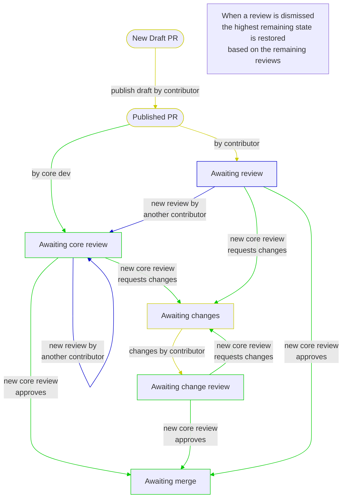

# bedevere

[](https://github.com/python/bedevere/actions)
[](https://codecov.io/gh/python/bedevere)

This bot is meant to help identify issues with a CPython pull request.

## Which repositories it runs on

Most of bedevere assumes CPython's workflow: `gh-NNNNN` issue numbers,
`Misc/NEWS.d` entries, `X.Y` maintenance branches and the awaiting-review
labels. So each repository the app is installed on runs only the features
enabled for it in [`bedevere/config.py`](bedevere/config.py).

### How it works

Every webhook goes to `dispatch()` in `bedevere/__main__.py`. It looks up the
repository the event came from with `config.features_for()`, then passes the
event to the router of each enabled feature, in the order of
`FEATURE_ROUTERS`. Features that aren't enabled never see the event.

- `python/cpython` runs every feature.
- A `python` org repository with no entry in `REPO_FEATURES` runs only
  `policy`, the AI policy labels. This is a safe default for a repository
  added to the installation before anyone has decided its features; it is
  not a limit, and an entry can turn on any of the features below.
- A repository outside the `python` org runs nothing unless it has an entry.
  Bedevere is meant for python org repositories only.
- Bedevere logs the first event it gets from a repository with no entry.
- Repository names are matched without regard to case.

| Feature     | What it does                                                                 |
| ----------- | ---------------------------------------------------------------------------- |
| `backport`  | `needs backport to X.Y` labels, the `[X.Y]` title status, copies labels to backports |
| `close_pr`  | Closes PRs that merge a maintenance branch into `main`                       |
| `filepaths` | `docs` and `tests` labels based on the files changed                         |
| `gh_issue`  | The `bedevere/issue-number` status for `gh-NNNNN` in the title               |
| `news`      | The `bedevere/news` status for `Misc/NEWS.d` entries                         |
| `policy`    | Comments on issues and PRs labeled `AI-needs-explanation` or `AI-guidelines-not-met`; the second label also closes the item and removes the first |
| `stage`     | The awaiting-review stage labels and comments                                |

`filepaths` also runs the NEWS check when a PR is opened or updated. It skips
that check when `news` is off, so a repository can have `filepaths` without
`news`.

### Which features fit a repository

Features are turned on or off per repository. None of them have per-repository
settings: a feature behaves the same on every repository that runs it.

| Feature     | Fits other python org repositories? |
| ----------- | ----------------------------------- |
| `policy`    | Yes. |
| `stage`     | Yes, if PRs are reviewed by members of the python org's **Python core** team. A review from anyone else counts as a non-core review, so a repository whose reviewers aren't in that team would leave PRs at `awaiting core review`. Its comments say "A Python core developer". |
| `filepaths` | Partly. It goes by file name, so it works on any repository: when a PR is opened, one that changes only docs files (`.rst`, `.md`, `.nitignore`) gets `docs`, and one that changes only test files (`test_*`, `_test*`), or tests mixed with docs, gets `tests`. But a docs-only PR with no `Misc/NEWS.d` entry also gets CPython's `skip news` label. |
| `close_pr`  | Only if `X.Y` branches are maintenance branches that must never be merged into `main`. Its comment links to CPython. |
| `gh_issue`, `news`, `backport` | No. They expect CPython's `gh-NNNNN` titles, `Misc/NEWS.d` entries and backport workflow, and post failing statuses or wrong labels elsewhere. |

### Setting up a repository

1. **Agree with the repository's maintainers** that they want bedevere, and
   which features from the table above.
2. **If they want more than `policy`, add the repository to `REPO_FEATURES`**
   in `bedevere/config.py`, with every feature it should run:

   ```python
   REPO_FEATURES = {
       "python/cpython": ALL_FEATURES,
       "python/devguide": frozenset({"policy", "stage"}),
   }
   ```

   Use the lowercase `owner/name`. An entry replaces the default, so list
   `policy` too unless the repository shouldn't have the AI policy labels.
   Open a pull request; the features take effect once it's merged and
   deployed. A repository that wants `policy` only needs no entry.
3. **Create the labels the features use** in the repository (Issues, Labels,
   New label). Copy each description from
   [CPython's labels](https://github.com/python/cpython/labels), since GitHub
   shows it in the label picker and it tells triagers what applying the label
   does. The colour doesn't matter to bedevere; copying it only keeps the
   labels looking the same across repositories.
   - `policy`: `AI-needs-explanation` (bedevere asks the author to explain
     the contribution in their own words) and `AI-guidelines-not-met`
     (bedevere comments, closes the issue or PR, and removes
     `AI-needs-explanation` if it's there). Either label does nothing on a
     closed item, and adding `AI-needs-explanation` to an item that already
     has `AI-guidelines-not-met` does nothing. People apply these, and
     bedevere acts only when the name matches exactly, including case. Until
     they exist bedevere does nothing, and a different spelling
     (`AI needs explanation`) is ignored without any error.
   - `stage`: `awaiting review`, `awaiting core review`, `awaiting changes`,
     `awaiting change review` and `awaiting merge`. Bedevere applies these
     itself; if one is missing, GitHub creates it with a default colour and
     no description.
4. **Add the repository to the installation.** A python org admin opens the
   org's settings, GitHub Apps, bedevere, Configure, and adds the repository
   under Repository access. If step 2 applies, do this after the deploy, or
   the repository runs `policy` only until then.
5. **Check that it works.** Open a test issue, apply `AI-needs-explanation`,
   and check that bedevere comments within a minute or so, then delete or
   close the issue. With `stage`, open a test PR and check it gets an
   `awaiting` label. If nothing happens, check the label names and the app's
   Recent Deliveries in its settings.
6. **Tell the repository's triagers** which features are on and what each
   label does.

To change a repository's features later, edit its entry and open a pull
request. To turn bedevere off on a repository, remove the repository from the
installation.

## What the bot does:
- ### Identifies missing GitHub issue numbers in the title
If no GitHub issue number is found the status fails and the
"Details" link points to the relevant
[section of the devguide](https://devguide.python.org/getting-started/pull-request-lifecycle.html#submitting).
- ### Links to GitHub issues
If an issue number is found then the "Details" link points to the relevant issue
itself, making it easier to navigate from PR to issue.
- ### Identifies missing news entry
If no `Misc/NEWS.d` entry is found or the news entry is formatted incorrectly
and the issue doesn't have the `skip-news` label, the status fails and a relevant
description label is added to it.
- ### Closes invalid PRs
Closes PRs that try to merge a maintenance branch into the main branch, adds
`invalid` label, and posts a relevant message.
- ### Remind Contributors about AI policy
Posts a reminder of the AI guidelines on issues and PRs labeled
`AI-needs-explanation` or `AI-guidelines-not-met`. The `AI-guidelines-not-met`
label also closes the contribution and removes `AI-needs-explanation` if it
is present. Adding `AI-needs-explanation` to an item that already has
`AI-guidelines-not-met` does nothing.
- ### Labels PRs for docs
Labels PRs for documentation as `docs`
- ### Copies `type-feature` label from issue to PR
If the GitHub issue referenced in the PR title is labeled `type-feature`,
the same label is added to the PR
- ### Copies main labels to backport
Copies labels from main PRs to backport PRs

## PR State Machine

This diagram represents the state machine for pull requests, and the labels
applied by Bedevere.

The colors represent who can make a state change or who is currently
blocking the PR from moving forward:
* Yellow: the PR creator
* Green: core developers
* Blue: anyone

<!--
  Changes to the labels in this flowchart should be reflected
  in the devguide: https://devguide.python.org/triage/labels/
-->



## *Aside*: where does the name come from?
Since this bot is about identifying pull requests that need changes,
it seemed fitting to name it after Sir Bedevere who knew
[how to identify a witch](https://youtu.be/yp_l5ntikaU).
